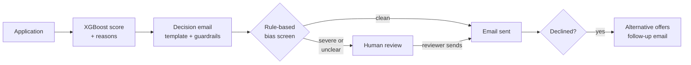
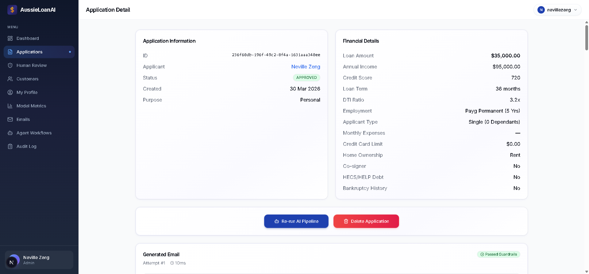

# Loan Approval AI System


[](https://github.com/zeroyuekun/loan-approval-ai-system/actions/workflows/ci.yml)


A loan approval system for Australian lending. A machine-learning model scores
each application, the system writes and sends the decision email, checks that
email for discriminatory wording, and offers declined customers other products.
It runs on your own machine at no cost, with no LLM in the default setup
([why](#the-optional-llm-check)).

> **Limits up front.** The model is trained on synthetic data that copies
> published Australian lending statistics, so it shows how the pipeline works;
> it is not a credit model for real customers. See the
> [model card](backend/docs/MODEL_CARD.md).

## For engineers reviewing this

A full-stack system: Django REST API, Celery workers, a Next.js dashboard, an
XGBoost model and a rule-based bias screen, all run with one `docker compose up`. About
2,600 backend tests and 480+ frontend tests run in CI. Running cost is $0.

Good places to start reading:

| Area | File |
|---|---|
| The pipeline (one Celery task, one `AgentRun` record per application) | [`agents/services/orchestrator.py`](backend/apps/agents/services/orchestrator.py) |
| Bias screen: rules first, optional LLM second | [`agents/services/deterministic_prescreen.py`](backend/apps/agents/services/deterministic_prescreen.py), [`agents/services/bias/core.py`](backend/apps/agents/services/bias/core.py) |
| Email guardrails | [`email_engine/services/guardrails/engine.py`](backend/apps/email_engine/services/guardrails/engine.py) |
| Scoring and the reasons behind a decision | [`ml_engine/services/scoring/predictor.py`](backend/apps/ml_engine/services/scoring/predictor.py), [`shap_attribution.py`](backend/apps/ml_engine/services/scoring/shap_attribution.py) |
| Human review and resuming a held run | [`agents/services/human_review_handler.py`](backend/apps/agents/services/human_review_handler.py) |

## What it does

1. **Scores the application.** An XGBoost model gives an approval probability
   and the main reasons behind it (SHAP), checked against Australian
   responsible-lending rules (serviceability buffer, living-cost benchmarks).
2. **Writes the decision email.** Compliance-checked templates fill in the
   real figures. Every email passes deterministic guardrails (required
   disclosures, no invented dollar amounts, no prohibited language) before it
   can be sent.
3. **Checks for bias.** Rule-based checks read every email. Clean emails are
   sent; severe or unclear ones wait for a human reviewer, whose decision is
   final. An optional LLM check can also read every decline in full.
4. **Offers alternatives.** A declined customer gets a follow-up with
   products they qualify for, with amounts and rates calculated by code, not
   by the AI.
5. **Explains itself.** Every applicant is told whether a person was involved
   in their decision and can ask for a human review.
6. **Shows the lending picture.** The staff dashboard summarises approvals
   over time, the main decline reasons, and how many decisions were made
   automatically, checked by staff, or changed by staff.



### The optional LLM check

By default no LLM runs anywhere. The rule-based screen decides alone: clean
emails are sent, and severe or unclear ones wait for a human.

An LLM check can be switched on (`BIAS_LLM_BACKEND`). It is a reviewer only: it
never writes to the customer and never makes the lending decision. It reads
every decline email in full, plus any email the rules could not judge, and
returns a bias score with the exact phrase behind it. That catches wording the
rules have no pattern for, such as "people at your stage of life rarely keep up
repayments". On the test set it flagged every biased email and cleared every
compliant one: 27 of 27 runs with Llama 3.1 8B locally, and 9 of 9 with
`openai/gpt-oss-20b` on Groq ([results](docs/experiments/bias_verdict_model.md)).

It is off for two reasons:

- **Memory.** Running Llama 3.1 8B locally takes about 6 GB of RAM on top of
  the rest of the stack, more than a 16 GB laptop can spare.
- **Privacy.** The free hosted option (Groq) would avoid the memory cost, but
  the email being checked (the applicant's name, the loan amount, the
  decision) would leave the machine. Private customer data should not be sent
  to a third-party API, so a real lender would run this check in-house.

<details>
<summary><strong>Screenshots</strong></summary>





</details>

## Run it

You need Docker Desktop (or Docker Engine with Compose v2) and about 4 GB of
free RAM. No API key is needed.

```bash
git clone https://github.com/zeroyuekun/loan-approval-ai-system.git
cd loan-approval-ai-system
cp .env.example .env        # then set DJANGO_SECRET_KEY, FIELD_ENCRYPTION_KEY and the passwords
docker compose up -d
make seed                   # generate synthetic data and train the model
```

- Dashboard: <http://localhost:3000>. Sign in with the
  `DJANGO_SUPERUSER_EMAIL` and `DJANGO_SUPERUSER_PASSWORD` from `.env`
  (sign-in is by email).
- API docs: <http://localhost:8000/api/docs/> (admin only, so log in first).
- Problems: see the [runbooks](docs/runbooks/).

**AI settings.** By default no LLM runs: emails come from templates
(`EMAIL_LLM_BACKEND=template`) and the bias check is rule-based
(`BIAS_LLM_BACKEND=none`). To turn the LLM check on, set `BIAS_LLM_BACKEND` to
`ollama` (local; also set `COMPOSE_PROFILES=ollama`, first start downloads
about 5 GB), `groq` (free hosted API with `openai/gpt-oss-20b`, needs a free
`GROQ_API_KEY` from console.groq.com) or `anthropic` (Claude, needs
`ANTHROPIC_API_KEY`). Groq's free tier allows only a few checks a minute;
beyond that, emails wait for a human until it recovers. Model choices and
results: [bias verdict model comparison](docs/experiments/bias_verdict_model.md).

## How I built this

I designed the architecture and made the product decisions: the three-stage
pipeline (score, email, bias check), the split into five Django apps,
deterministic checks before any AI, template-first emails with cost caps, the
pluggable LLM backends and the fairness approach. I wrote parts of the code by hand
and used AI (Claude Code) as a pair programmer for much of the implementation.
I reviewed every change, set the testing strategy, and debugged issues across
the project's pull requests.

Choices that could be measured were measured first. The bias reviewer model was
picked by running the same labelled emails through each candidate
(`tools/bias_model_eval.py`), and when Groq retired the first hosted model, the
same harness picked its replacement. The
[engineering journal](docs/engineering-journal.md) records how the project was
built, what went wrong, and why decisions changed.

## Tech

| Layer | Tools |
|---|---|
| Backend | Django 5, Django REST Framework, PostgreSQL 17, Celery + Redis |
| Frontend | Next.js 16, React 19, TanStack Query, Tailwind, shadcn/ui |
| Machine learning | XGBoost, scikit-learn, SHAP, Optuna |
| AI | Optional bias reviewer: Llama 3.1 8B (local Ollama), gpt-oss-20b (Groq) or Claude; off by default |
| Infrastructure | Docker Compose; Kubernetes manifests and Terraform for AWS (not deployed) |

## Design decisions

| Decision | Why |
|---|---|
| Deterministic checks before any AI | Rules are predictable and auditable; the AI only judges the ambiguous cases ([ADR 003](docs/adr/003-hybrid-bias-detection.md)) |
| Template-first emails | A lending letter must state exact figures; templates cannot invent them ([ADR 006](docs/adr/006-template-first-email-with-cost-cap.md)) |
| LLM bias check off by default | A local model needs about 6 GB of RAM, and a hosted one would send customer data off the machine; the rule-based screen plus human review covers the gap ([why](#the-optional-llm-check), [ADR 010](docs/adr/010-pluggable-email-llm-backend-data-safety.md)) |
| XGBoost with monotonic constraints | Higher income can never lower the score, which keeps decisions explainable ([ADR 002](docs/adr/002-xgboost-with-monotonic-constraints.md)) |
| Synthetic data calibrated to public statistics | No real loan data is available ([ADR 001](docs/adr/001-synthetic-data-with-copula.md)) |

All decision records: [docs/adr](docs/adr/README.md).

<details>
<summary><strong>Model details</strong></summary>

XGBoost trained on synthetic Australian lending data calibrated to ATO, ABS,
APRA and Equifax published statistics, with noise and hidden factors so the
results are realistic rather than perfect. Test AUC on the synthetic holdout is
0.88 (5-fold CV 0.87); details and limits are in the
[model card](backend/docs/MODEL_CARD.md). Training uses Optuna tuning,
isotonic calibration and monotonic constraints. The project also includes
drift monitoring (PSI), a scorecard baseline for comparison, and APRA-style
stress testing.

Retrain:

```bash
docker compose exec backend python manage.py generate_data --num-records 10000
docker compose exec backend python manage.py train_model --algorithm xgb
```

</details>

<details>
<summary><strong>Compliance features</strong></summary>

- Responsible-lending checks: serviceability with a 3% rate buffer and
  living-cost benchmarks.
- Decision emails include the required elements (complaints body, hardship
  and contact details) and are checked for prohibited language and invented
  figures before sending; an email that fails is withheld, not sent.
- Automated-decision disclosure (Privacy Act reforms): every decision says
  whether it was fully automated, assisted, or made by a person, and declined
  applicants can request a human review.
- Customers can export their data (Privacy Act APP 12).

These are implemented as engineering features, not reviewed by a compliance
professional.

</details>

<details>
<summary><strong>Security</strong></summary>

JWT in HttpOnly cookies with refresh rotation and blacklisting, CSRF protection,
Argon2 password hashing, field-level encryption for personal data, per-endpoint
role checks and rate limits, a per-request CSP nonce, and prompt-injection
defences on any text that reaches an AI prompt. Logs are scrubbed of personal
data. Details: [ADR 008](docs/adr/008-security-architecture.md).

</details>

<details>
<summary><strong>Testing</strong></summary>

About 2,600 backend tests (pytest) and 480+ frontend tests (vitest).

CI runs Ruff, Bandit, gitleaks, npm audit, Trivy image scans and an end-to-end
smoke test (`tools/smoke_e2e.sh`: register, apply, decide, email).

Run the backend tests locally (the runtime image does not ship pytest):

```bash
docker compose exec backend bash -lc "pip install -q --user pytest pytest-django && python -m pytest"
```

Frontend: `cd frontend && npx vitest run`.

</details>

<details>
<summary><strong>Project layout</strong></summary>

```
backend/apps/
  accounts/      login, roles (admin, officer, customer), data export
  loans/         applications, decisions, audit log
  ml_engine/     data generation, training, prediction, drift
  email_engine/  templates, guardrails, email delivery
  agents/        bias checks, alternative offers, pipeline orchestrator
frontend/src/    Next.js dashboard and customer portal
tools/           standalone scripts (benchmarks, smoke test, model comparison)
workflows/       step-by-step operating procedures
k8s/, terraform/ deployment manifests (not deployed)
```

</details>

## License

MIT
