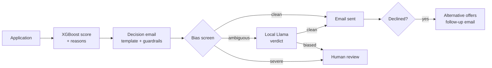
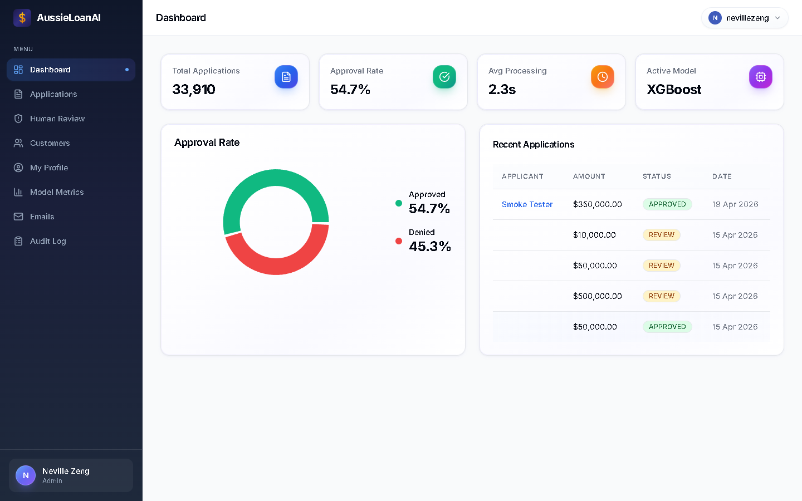
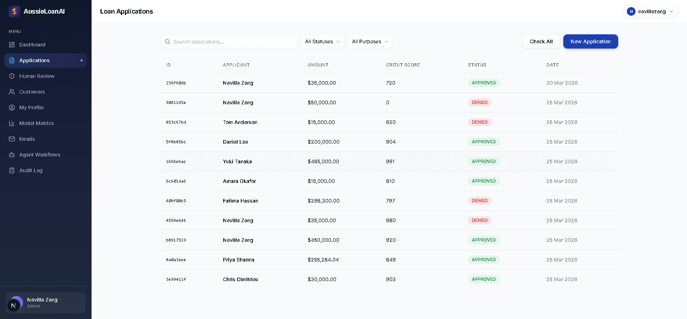
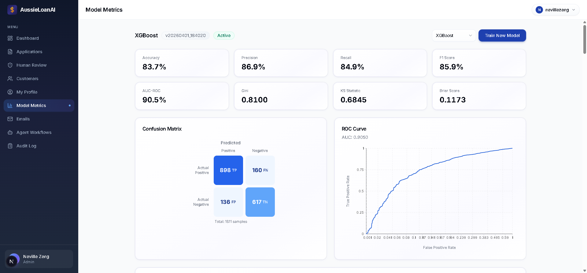
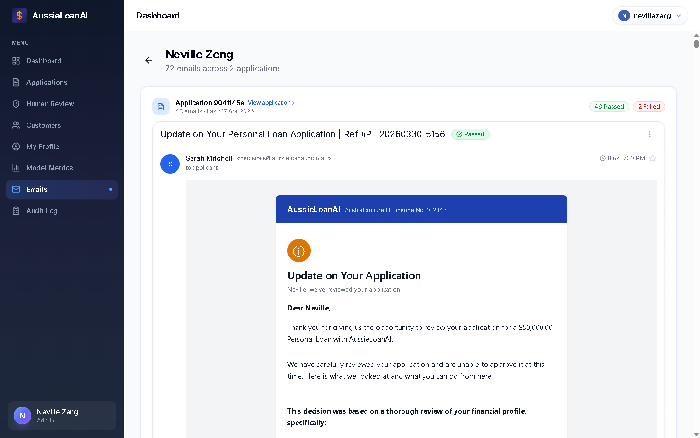

# Loan Approval AI System


[](https://github.com/zeroyuekun/loan-approval-ai-system/actions/workflows/ci.yml)


A loan approval system for Australian lending. A machine-learning model scores
each application, the system writes and sends the decision email, checks that
email for discriminatory wording, and offers declined customers other products.
Everything runs on your own machine, including the AI, at no cost.

> **Limits up front.** The model is trained on synthetic data that copies
> published Australian lending statistics, so it shows how the pipeline works;
> it is not a credit model for real customers. See the
> [model card](backend/docs/MODEL_CARD.md).

## What it does

1. **Scores the application.** An XGBoost model gives an approval probability
   and the main reasons behind it (SHAP), checked against Australian
   responsible-lending rules (serviceability buffer, living-cost benchmarks).
2. **Writes the decision email.** Compliance-checked templates fill in the
   real figures. Every email passes deterministic guardrails (required
   disclosures, no invented dollar amounts, no prohibited language) before it
   can be sent.
3. **Checks for bias.** A rule-based screen scores every email. Only
   ambiguous cases go to a local AI model (Llama 3.1 8B), and anything it
   confirms as biased goes to a human reviewer.
4. **Offers alternatives.** A declined customer gets a follow-up with
   products they qualify for, with amounts and rates calculated by code, not
   by the AI.
5. **Explains itself.** Every applicant is told whether a person was involved
   in their decision and can ask for a human review.



<details>
<summary><strong>Screenshots</strong></summary>







</details>

## Run it

You need Docker Desktop (or Docker Engine with Compose v2) and about 10 GB of
free RAM for the full stack with the local AI model. No API key is needed.

```bash
git clone https://github.com/zeroyuekun/loan-approval-ai-system.git
cd loan-approval-ai-system
cp .env.example .env        # then set DJANGO_SECRET_KEY, FIELD_ENCRYPTION_KEY and the passwords
docker compose up -d        # first start downloads Llama 3.1 8B (~5 GB)
make seed                   # generate synthetic data and train the model
```

- Dashboard: <http://localhost:3000>. Log in as `admin` with the
  `DJANGO_SUPERUSER_PASSWORD` from `.env`.
- API docs: <http://localhost:8000/api/schema/swagger-ui/>.
- Problems: see the [runbooks](docs/runbooks/).

**AI settings.** By default the AI runs locally through Ollama
(`COMPOSE_PROFILES=ollama`, `BIAS_LLM_BACKEND=ollama`, `BIAS_OLLAMA_MODEL=llama3.1:8b`)
and emails come from templates (`EMAIL_LLM_BACKEND=template`). Nothing leaves
your machine. If you leave Ollama off, the bias screen still runs and any
ambiguous email waits for a human. Claude is optional: set a backend to
`anthropic` and add `ANTHROPIC_API_KEY`. Why Llama 3.1 8B and not a smaller
model: [bias verdict model comparison](docs/experiments/bias_verdict_model.md).

## How I built this

I designed the architecture and made the product decisions: the three-stage
pipeline (score, email, bias check), the split into five Django apps,
deterministic checks before any AI, template-first emails with cost caps, the
local-model setup and the fairness approach. I wrote parts of the code by hand
and used AI (Claude Code) as a pair programmer for much of the implementation.
I reviewed every change, set the testing strategy, and debugged issues across
the project's pull requests.

## Tech

| Layer | Tools |
|---|---|
| Backend | Django 5, Django REST Framework, PostgreSQL 17, Celery + Redis |
| Frontend | Next.js 16, React 19, TanStack Query, Tailwind, shadcn/ui |
| Machine learning | XGBoost, scikit-learn, SHAP, Optuna |
| AI | Llama 3.1 8B on Ollama (local); Claude optional |
| Infrastructure | Docker Compose; Kubernetes manifests and Terraform for AWS (not deployed) |

## Design decisions

| Decision | Why |
|---|---|
| Deterministic checks before any AI | Rules are predictable and auditable; the AI only judges the ambiguous cases ([ADR 003](docs/adr/003-hybrid-bias-detection.md)) |
| Template-first emails | A lending letter must state exact figures; templates cannot invent them ([ADR 006](docs/adr/006-template-first-email-with-cost-cap.md)) |
| Local Llama for verdicts | $0 running cost and no customer data leaves the machine ([ADR 010](docs/adr/010-pluggable-email-llm-backend-data-safety.md)) |
| XGBoost with monotonic constraints | Higher income can never lower the score, which keeps decisions explainable ([ADR 002](docs/adr/002-xgboost-with-monotonic-constraints.md)) |
| Synthetic data calibrated to public statistics | No real loan data is available ([ADR 001](docs/adr/001-synthetic-data-with-copula.md)) |

All decision records: [docs/adr](docs/adr/README.md).

<details>
<summary><strong>Model details</strong></summary>

XGBoost trained on synthetic Australian lending data calibrated to ATO, ABS,
APRA and Equifax published statistics, with noise and hidden factors so the
results are realistic rather than perfect. Test AUC on the synthetic holdout is
0.88 (5-fold CV 0.87); details and limits are in the
[model card](backend/docs/MODEL_CARD.md). Training uses Optuna tuning,
isotonic calibration and monotonic constraints. The project also includes
drift monitoring (PSI), a scorecard baseline for comparison, and APRA-style
stress testing.

Retrain:

```bash
docker compose exec backend python manage.py generate_data --num-records 10000
docker compose exec backend python manage.py train_model --algorithm xgb
```

</details>

<details>
<summary><strong>Compliance features</strong></summary>

- Responsible-lending checks: serviceability with a 3% rate buffer and
  living-cost benchmarks.
- Decision emails include the required elements (complaints body, hardship
  and contact details) and are checked for prohibited language and invented
  figures before sending; an email that fails is withheld, not sent.
- Automated-decision disclosure (Privacy Act reforms): every decision says
  whether it was fully automated, assisted, or made by a person, and declined
  applicants can request a human review.
- Customers can export their data (Privacy Act APP 12).

These are implemented as engineering features, not reviewed by a compliance
professional.

</details>

<details>
<summary><strong>Security</strong></summary>

JWT in HttpOnly cookies with refresh rotation and blacklisting, CSRF protection,
Argon2 password hashing, field-level encryption for personal data, per-endpoint
role checks and rate limits, a per-request CSP nonce, and prompt-injection
defences on any text that reaches an AI prompt. Logs are scrubbed of personal
data. Details: [ADR 008](docs/adr/008-security-architecture.md).

</details>

<details>
<summary><strong>Testing</strong></summary>

About 2,500 backend tests (pytest) and 480+ frontend tests (vitest).

CI runs Ruff, Bandit, gitleaks, npm audit, Trivy image scans and an end-to-end
smoke test (`tools/smoke_e2e.sh`: register, apply, decide, email).

Run the backend tests locally (the runtime image does not ship pytest):

```bash
docker compose exec backend bash -lc "pip install -q --user pytest pytest-django && python -m pytest"
```

Frontend: `cd frontend && npx vitest run`.

</details>

<details>
<summary><strong>Project layout</strong></summary>

```
backend/apps/
  accounts/      login, roles (admin, officer, customer), data export
  loans/         applications, decisions, audit log
  ml_engine/     data generation, training, prediction, drift
  email_engine/  templates, guardrails, email delivery
  agents/        bias checks, alternative offers, pipeline orchestrator
frontend/src/    Next.js dashboard and customer portal
tools/           standalone scripts (benchmarks, smoke test, model comparison)
workflows/       step-by-step operating procedures
k8s/, terraform/ deployment manifests (not deployed)
```

</details>

## License

MIT
